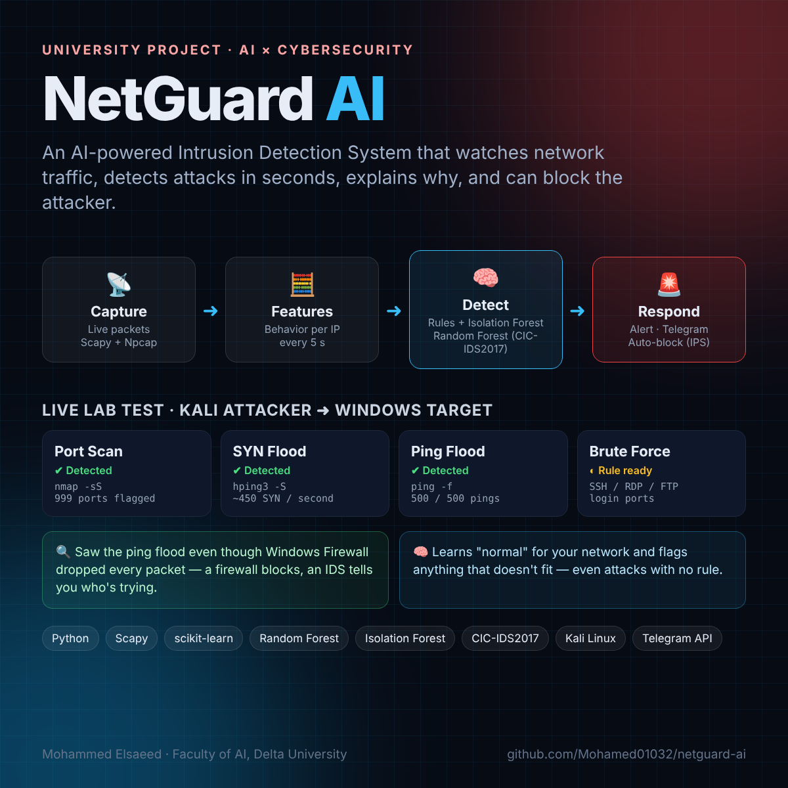
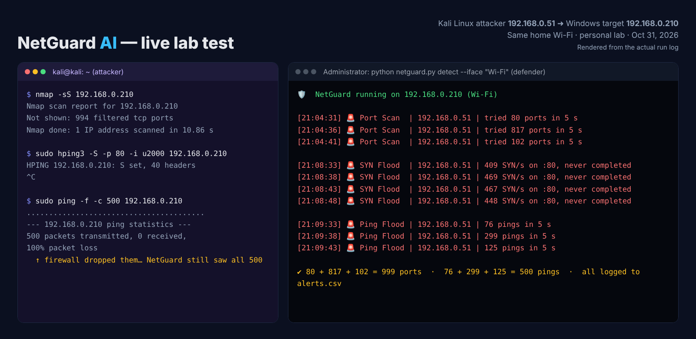

<div align="center">

# 🛡️ NetGuard AI

**An AI-powered Network Intrusion Detection System (IDS) that detects attacks in seconds, explains why, and can block the attacker.**




</div>

---

## ✨ What it does

NetGuard watches the traffic coming into a machine, summarizes how every source IP behaves, and decides whether that behavior is an attack.

| | |
|---|---|
| 📡 **Live capture** | Sniffs packets in real time with Scapy + Npcap/libpcap |
| 🧮 **Behavioral features** | Every 5 s: new connection attempts (SYN), unique ports, port concentration, login-port hits, UDP, ICMP |
| 🧠 **Two detection layers** | Explainable rules name the attack · an **Isolation Forest** learns *normal* and flags anything that doesn't fit |
| 🌲 **Trained classifier** | Random Forest on **CIC-IDS2017** (2.8M real flows, 6 attack families) |
| 🚨 **Response** | Console alerts, CSV log, Telegram notifications, optional **auto-block** (Windows Firewall / iptables) |

## 🧪 Live lab test

Kali Linux (attacker) vs. Windows laptop (defender) on the same Wi-Fi, in my personal lab:



| Attack | Tool | Result |
|---|---|---|
| Port Scan | `nmap -sS` | ✅ Detected — 999 of nmap's 1000 ports accounted for across 3 alerts |
| SYN Flood (DoS) | `hping3 -S` | ✅ Detected — ~450 half-open SYN/s on port 80 |
| Ping Flood | `ping -f` | ✅ Detected — all 500 pings counted |
| Brute Force | SSH / RDP / FTP login ports | Rule implemented, live test pending |

> 💡 Windows Firewall dropped every ping (`100% packet loss` on Kali), yet NetGuard still counted all 500.
> **A firewall blocks. An IDS tells you who is trying, and how.**

## 🗂️ Project structure

```
netguard-ai/
├── lite/                 # Live prototype (works today)
│   └── netguard.py       # capture → features → rules + Isolation Forest → alert / block
├── training/             # Phase 1: model trained on CIC-IDS2017
│   └── train_ids.py      # clean → group labels → Random Forest → metrics + plots
└── docs/                 # images
```

## 🚀 Quick start — live prototype

> ⚖️ **Only test on machines and networks you own.** Attacking systems without permission is illegal.

```bash
pip install -r requirements.txt
cd lite

python netguard.py list                          # find your interface
python netguard.py learn  --iface "Wi-Fi"        # learn normal traffic (3 min)
python netguard.py detect --iface "Wi-Fi"        # monitor
python netguard.py detect --iface "Wi-Fi" --block   # monitor + auto-block
```

Run as **Administrator** (Windows, needs [Npcap](https://npcap.com)) or with `sudo` (Linux).
Optional Telegram alerts: set `TELEGRAM_TOKEN` and `CHAT_ID` environment variables.

Then attack yourself from another machine on the same network:

```bash
nmap -sS <target-ip>                              # Port Scan
sudo hping3 -S -p 80 -i u2000 <target-ip>         # SYN Flood (stop after ~10 s)
sudo ping -f -c 500 <target-ip>                   # Ping Flood
```

## 🌲 Phase 1 — training on CIC-IDS2017

1. Download `MachineLearningCSV.zip` from the [Canadian Institute for Cybersecurity](https://www.unb.ca/cic/datasets/ids-2017.html) and unzip it.
2. Train:

```bash
cd training
python train_ids.py --data MachineLearningCVE --sample 0.3
```

Outputs in `results/`: per-class precision/recall/F1, **Detection Rate**, **False Positive Rate**, confusion matrix, top features and the saved model.

> Note: the original CIC-IDS2017 has known labeling issues (Engelen et al., 2021). The project will also evaluate on the corrected version.

## 🛣️ Roadmap

- [x] Live capture + behavioral features
- [x] Explainable rule engine (Port Scan, SYN Flood, Brute Force, Ping Flood)
- [x] Isolation Forest anomaly detection (learns your network's normal)
- [x] Telegram alerts + auto-block (IPS mode)
- [x] Random Forest training pipeline on CIC-IDS2017
- [ ] CICFlowMeter on live traffic, so the trained model judges real flows
- [ ] Autoencoder for zero-day / unknown attacks
- [ ] SHAP explanations + LLM-written incident summaries
- [ ] Web dashboard
- [ ] Benchmark against Suricata on the same attacks

## 👤 Author

**Mohammed Elsaeed** — Faculty of Artificial Intelligence, Delta University for Science and Technology (Egypt)
[LinkedIn](https://www.linkedin.com/in/mohammed-elsaeed-954a01356) · [GitHub](https://github.com/Mohamed01032)

## 📄 License

MIT
